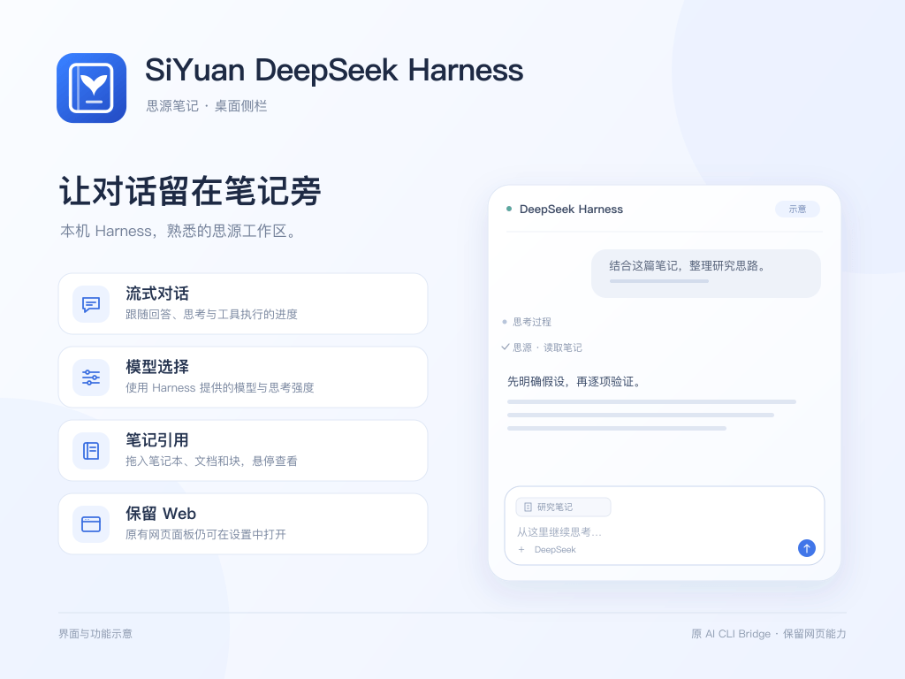

# SiYuan DeepSeek Harness

Chat with a locally installed DeepSeek Harness inside SiYuan. Stream replies, reasoning and tool activity, and drag notebooks, documents or blocks into the conversation.

This is an upgrade of **AI CLI Bridge**. The repository and plugin ID remain `siyuan-plugins-ai-cli-bridge`; the original Web panel, saved URL and block-ID drag-and-drop are preserved.



## Use

Install or update from the SiYuan marketplace. Install DeepSeek Harness independently and complete its account/API configuration first. The plugin discovers the local runtime and reuses existing credentials. Harness requires a desktop frontend; browser and mobile frontends retain the Web panel.

New installations start in Harness. Existing Web configurations retain their mode and URL. Use **Harness** above the Web panel to return to chat. Plugin settings offer a default-panel selector and Web URL. Harness settings also include **网页面板 / Open Web panel**.

- Select models and reasoning effort from the live Harness catalogue.
- Stream text, reasoning and tools; stop and continue the same session.
- Compact, Balanced and Full display levels; Balanced folds activity after the entire turn finishes.
- Drop notebooks/documents/blocks anywhere in the sidebar. Only the composer highlights; at most six references are accepted.
- Document/block references carry bounded snapshots and use native SiYuan hover previews. Valid SiYuan links in replies also preview and navigate.
- Notebook attachments define a retrieval scope rather than loading every document; connected note tools retrieve content as needed.
- Saved conversations, safe Markdown and locally scrolling tables.

[SiYuan Sisyphus](https://github.com/yangtaihong59/siyuan-plugins-mcp-sisyphus) is the recommended note MCP server. The agent briefly suggests installing and connecting it when note tools are needed but unavailable. The plugin does not change global Harness profiles or auto-enable MCP for new users.

## Web panel and data

Set a complete HTTP/HTTPS URL in settings. The original iframe, waiting/error views, automatic retry, resizing behavior and block-ID text drag support remain. Website framing policy and authentication still apply.

Web configuration retains `ai-agent-bridge-config`. Harness state uses this plugin's separate `harness-state.json`. Data from the standalone trial plugin stays in its original namespace and is not deleted or automatically merged. Leaving Harness closes its owned idle runtime; stop generation before switching panels.

Conversations and references may sync with the workspace. Submitted content goes to the model service configured in Harness, whose profile controls file, shell and network access. MCP tokens are excluded from saved state and patches. Replies never execute HTML. Complete approvals, queued steering, file/PDF uploads and @ search are not implemented.

## Development

```sh
pnpm install
pnpm dev
pnpm make-link
pnpm check
pnpm test
pnpm build
```

`make-link` lets you select the workspace, or use `pnpm make-link --workspace /absolute/workspace`. It links `dev/` without overwriting an existing installation. Stop the plugin and back up an old directory before replacing it. `dist/` and `package.zip` retain the original plugin ID.

`pnpm preview:ui` uses shared components and demo data without a model or notes. The build checks the CJS entry, the Web branch without Node, switching guards and unload behavior. See [中文说明](README_zh_CN.md) and [ACCEPTANCE.md](ACCEPTANCE.md).

MIT License.
